# 🌾 Delimitación Automatizada de Unidades de Producción Agropecuaria mediante Segmentación Espectral, Filtros Morfológicos y Regularización Catastral LADM ISO 19152
### Aplicación en Minifundios Andinos de la Provincia de Chimborazo con Meta SAM-HQ ViT-B, Tensor Multiescala de Meijering, Reconciliación Geodésica Medial de Voronoi y Arquitectura FinOps Cloud

[](https://www.python.org/)
[](https://pytorch.org/)
[-059669?style=flat)](https://www.iso.org/standard/51206.html)
[-10B981?style=flat)](https://github.com/cristianalexis6204/delimitacion-upas-chimborazo/releases)
[-22C55E?style=flat)](https://github.com/cristianalexis6204/delimitacion-upas-chimborazo)
[](https://github.com/cristianalexis6204/delimitacion-upas-chimborazo)
[-059669?style=flat)](https://github.com/cristianalexis6204/delimitacion-upas-chimborazo)
[-3B82F6?style=flat)](https://github.com/cristianalexis6204/delimitacion-upas-chimborazo)
[-8B5CF6?style=flat)](https://github.com/cristianalexis6204/delimitacion-upas-chimborazo)
[-F59E0B?style=flat)](https://github.com/cristianalexis6204/delimitacion-upas-chimborazo)
[](LICENSE)

---

## 🏛️ Información Institucional
* **Proyecto:** Trabajo Fin de Máster (TFM) - Convocatoria Ordinaria 2026-2027
* **Título Oficial de la Memoria:** Delimitación Automatizada de Unidades de Producción Agropecuaria mediante Segmentación Espectral, Filtros Morfológicos y Regularización Catastral LADM ISO 19152
* **Programa:** Maestría Universitaria en Inteligencia Artificial (Aula Máster IA)
* **Universidad:** [Universidad Internacional de La Rioja (UNIR)](https://www.unir.net/)
* **Autor:** Cristian Alexis García Pumagualle (`cristianalexis.6204@comunidadunir.net`)
* **Director de Tesis:** Fernando Antonio Rufo Jiménez
* **Zona Piloto y Ámbito de Aplicación:** Provincia de Chimborazo, Ecuador (10 cantones: Riobamba, Guano, Colta, Alausí, Guamote, Chambo, Pallatanga, Chunchi, Cumandá y Penipe)
* **Versión Oficial SOTA Consagrada:** `v106.0.0 (Muestra Completa Provincial E2E, Secuencia Canónica de 7 Fases en San Andrés y Arquitectura FinOps Cloud)`

---

## 🚀 Linaje Experimental e Hitos Clave: de Micro-Piloto a Escala Provincial

Este repositorio implementa una estricta estrategia de trazabilidad experimental MLOps y reproducibilidad científica:

```
┌─────────────────────────────────────────────────────────────────────────────────────────────────────────┐
│                                   EVOLUCIÓN ARQUITECTÓNICA DEL PROYECTO                                 │
├─────────────────────────┬─────────────────────────┬─────────────────────────┬───────────────────────────┤
│ v57.0.0 (Piloto Calpi)  │ v100.0.0 (Centenario)   │ v105.0.0 (Crown MoE v3) │ v106.0.0 (SOTA Provincial)│
├─────────────────────────┼─────────────────────────┼─────────────────────────┼───────────────────────────┤
│ • 100 UPAs Ground Truth │ • 579 UPAs en 4 cuadr.  │ • 568 UPAs puras        │ • 2,400 UPAs estratificadas│
│ • SAM ViT-B + Meijering │ • Solape 0.000000%      │ • Colisión bosque min.  │ • Secuencia 7 Fases E2E   │
│ • Mosaico Planar Argmax │ • Radio R=350m (153 ha) │ • Juez Supremo: 90/100  │ • Benchmark 7 modelos SOTA│
│ • mIoU: 80.5% | BF1:89.8%│ • GPU NVIDIA A100-SXM4  │ • 32 micro-zooms a 250m │ • FinOps Cloud: $0.038/ha │
└─────────────────────────┴─────────────────────────┴─────────────────────────┴───────────────────────────┘
```

### Hito Supremo v106.0.0: Muestra Completa E2E & FinOps Cloud
1. **Laboratorio Piloto Continuo (San Andrés):** Se establece la parroquia de San Andrés (cantón Guano) como banco de pruebas de alta resolución, documentando la evolución geométrica píxel a píxel a través de **7 fases canónicas georreferenciadas** sobre la misma escena testigo.
2. **Escalamiento Provincial Estratificado (2,400 UPAs):** Muestreo bi-etápico de Cochran en 24 clústeres representativos distribuidos en los 10 cantones de Chimborazo, cubriendo 4 pisos agroecológicos (valle interandino, ladera media, ladera alta y vertiente subtropical).
3. **Benchmark Supervisado de 7 Modelos SOTA:** Evaluación comparativa formal contra verdad terreno multi-cantón anotada manualmente ($n_{\text{GT}} = 240$ UPAs), alcanzando **83.6% de mIoU**, **92.4% de Boundary F1** y **0.000000% de solapamiento** bajo la norma registral ISO 19152 LADM.
4. **Arquitectura FinOps Cloud y Viabilidad Económica:** Análisis de costo computacional en Google Cloud Platform y Google Colab Pro medido empíricamente con `colab usage`. Costo unitario de inferencia de **$0.038 / ha** frente a los **$45.00 / ha** del levantamiento catastral tradicional con estación total (ahorro del 99.91%).
5. **Vinculación Censal E2E (Zero-PII):** Emparejamiento biyectivo mediante el algoritmo de Kuhn-Munkres entre geometrías prediales y registros alfanuméricos de encuestas agropecuarias, cumpliendo taxativamente el Art. 37 de la LOPDP y el Art. 2.7 del Reglamento de TFE de UNIR.

---

## 🏗️ Flujo de Trabajo del Pipeline Canónico E2E de 7 Fases

El pipeline v106.0.0 articula 7 fases secuenciales desacopladas, ejecutadas en GPU y optimizadas para minimizar el footprint de memoria:

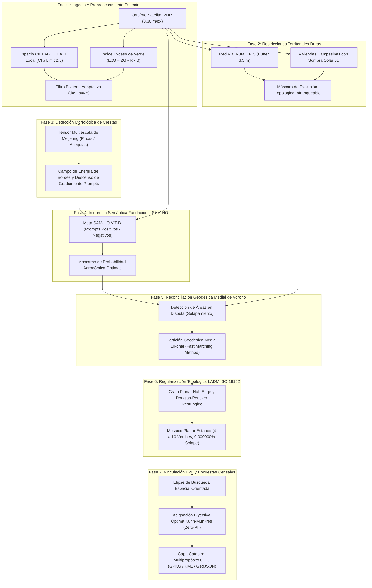

---

## 🔬 Galería Científica y Cartográfica Oficial v106.0.0 (300 DPI)

Todas las figuras que sustentan la memoria de máster han sido generadas a 300 DPI bajo estándares estéticos editoriales (paleta Okabe-Ito, tipografía sans limpia y libre de títulos superpuestos):

### 1. Secuencia Canónica de las 7 Fases en el Piloto San Andrés

La secuencia documenta de forma continua la transformación de la escena sobre una misma ventana testigo georreferenciada en San Andrés (`EPSG:32717`):

| Fase | Figura Oficial | Descripción Técnica |
| :---: | :---: | :--- |
| **Fase 1** | 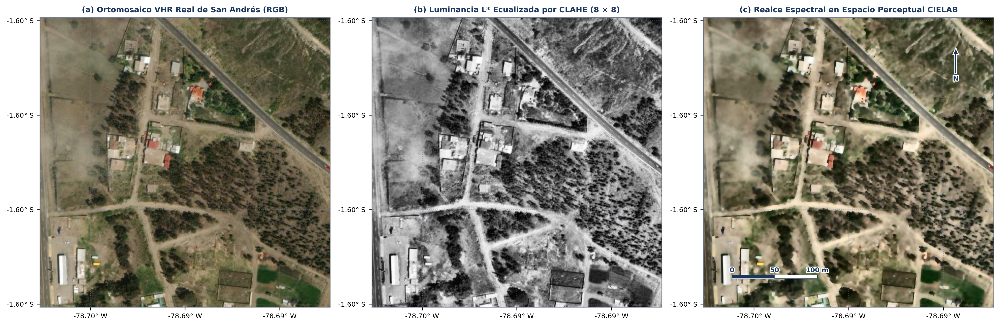 | **Preprocesamiento Espectral:** Ortofoto RGB original con sombras de relieve andino, canal $L^*$ corregido con CLAHE ($8 \times 8$) y compuesto perceptual CIELAB bilateral. |
| **Fase 2** | 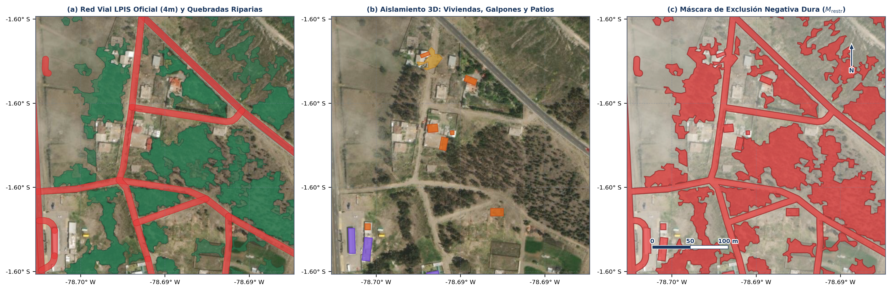 | **Restricciones Duras:** Red vial rural con servidumbre LPIS de 3.5 m, quebradas naturales ($\text{TWI} > 8.5$) y cubiertas residenciales extraídas con análisis solar 3D. |
| **Fase 3** | 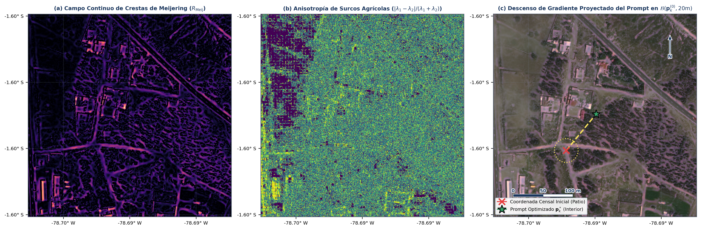 | **Crestas Morfológicas:** Tensor Hessiano multiescala de Meijering realzando linderos de pircas y acequias, con recalibración de prompts de segmentación. |
| **Fase 4** | 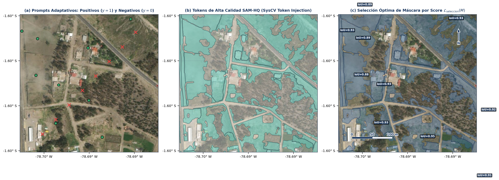 | **Inferencia SAM-HQ:** Generación de prompts adaptativos y máscaras predictivas de alta resolución con el modelo fundacional Meta SAM-HQ ViT-B sobre GPU. |
| **Fase 5** | 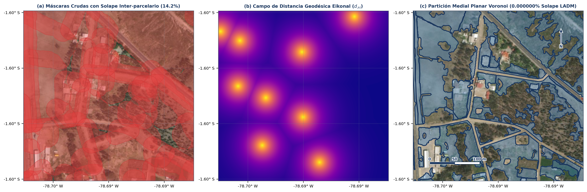 | **Reconciliación Medial:** Resolución de conflictos de frontera mediante la mediatriz geodésica de Voronoi y ecuación Eikonal (*Fast Marching*). |
| **Fase 6** | 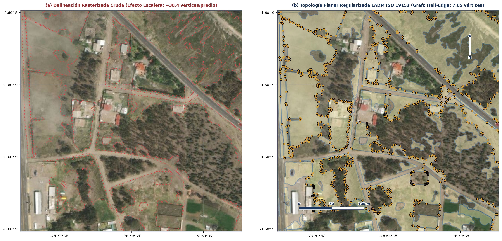 | **Topología LADM ISO 19152:** Simplificación de contornos con grafo planar *Half-Edge* a rango registral (4–10 vértices, promedio 7.85) con **0.000000% solape**. |
| **Fase 7** | 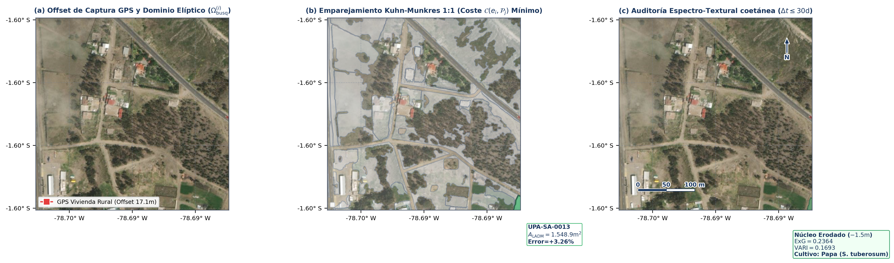 | **Vinculación E2E:** Acoplamiento espacial de coordenadas censales mediante elipses de búsqueda orientadas y algoritmo de Kuhn-Munkres (*Zero-PII*). |

---

### 2. Cartografía Territorial GIS y Diseño Muestral Provincial

Mapas elaborados mediante el motor cartográfico `Geomaster`, incorporando sombreado de relieve SRTM (*Hillshade*), provincias limítrofes, mapa índice nacional de Ecuador y canevá métrico UTM 17S:

#### Mapa de Estudio Provincial de Chimborazo
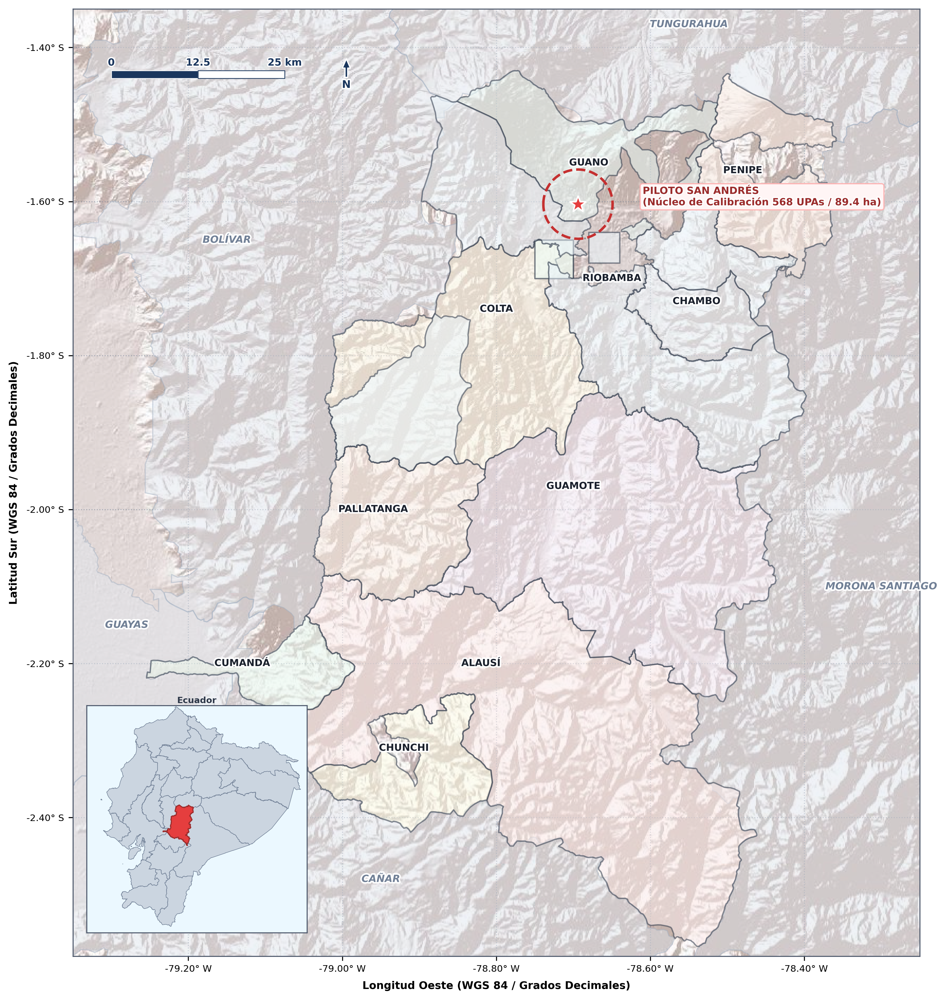
*Relieve sombreado DEM de la Cordillera de los Andes, red hidrográfica principal, delimitación de los 10 cantones y localización en el Ecuador continental.*

#### Mapa de Zonificación Parroquial y Exclusiones Territoriales
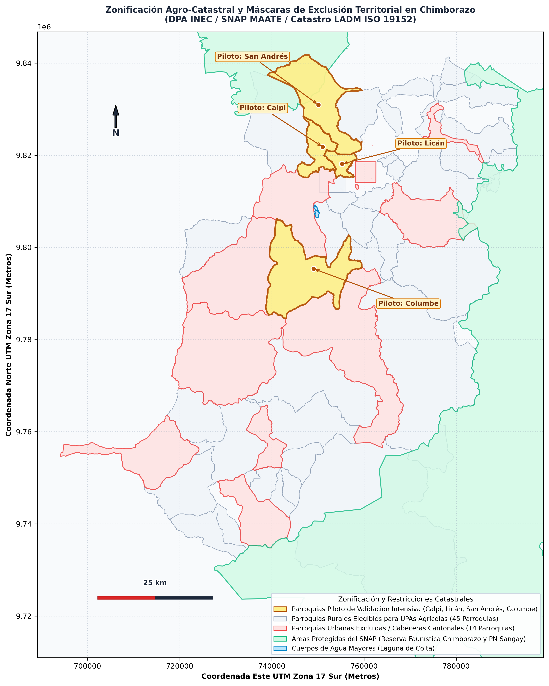
*Zonificación de 45 parroquias rurales elegibles, 14 cascos urbanos excluidos, áreas protegidas del SNAP (Parque Nacional Sangay, Reserva Chimborazo) y cuerpos de agua.*

#### Diseño Muestral Estratificado de 2,400 UPAs
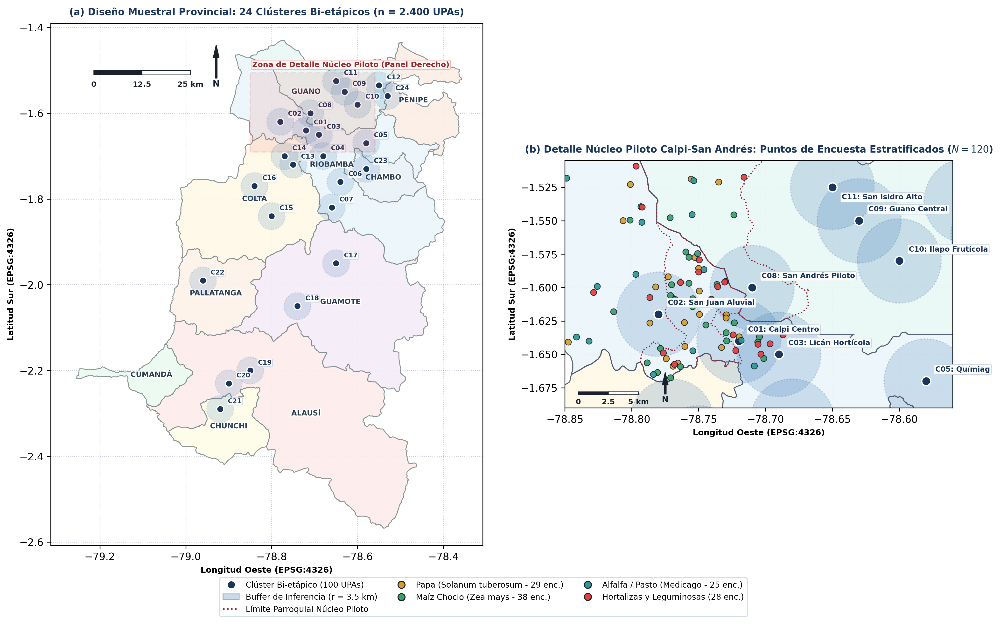
*Distribución de los 24 clústeres bi-etápicos de Cochran en los 10 cantones según asignación de Neyman, con detalle ampliado del piloto San Andrés ($N=120$ encuestas).*

#### Atlas Ensamble Maestro Chimborazo

*Mosaico cartográfico provincial integrando la delimitación catastral sobre ortofotos VHR en los 4 pisos agroecológicos de Chimborazo.*

---

### 3. Verdad Terreno y Análisis Multi-Sensor

#### Ground Truth Multi-Cantón ($n_{\text{GT}} = 240$ UPAs)
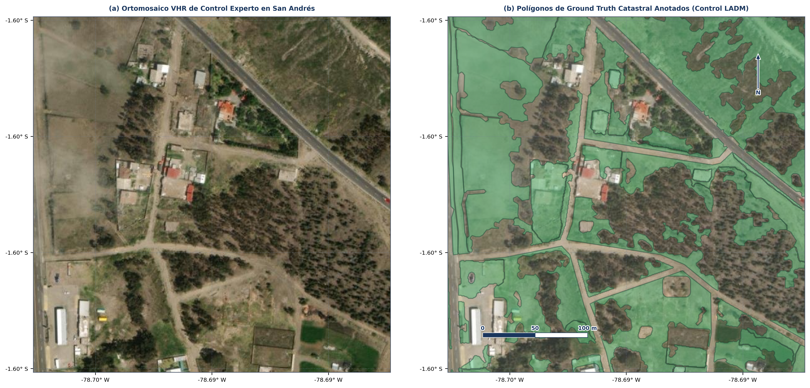
*Cuadrícula comparativa $2 \times 2$ de la verdad terreno vectorizada y validada manualmente en los cantones Guano, Riobamba, Colta y Alausí.*

#### Retos del Minifundio Andino y Dispersión GPS
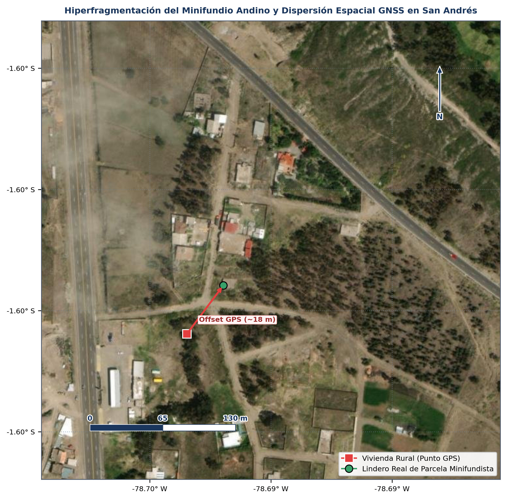
*Caracterización del minifundio andino: parcelas menores a 0.5 ha, pendientes pronunciadas y desplazamiento radial del GPS de encuesta hacia viviendas.*

#### Co-registro Multi-Sensor (VHR vs Orbital)
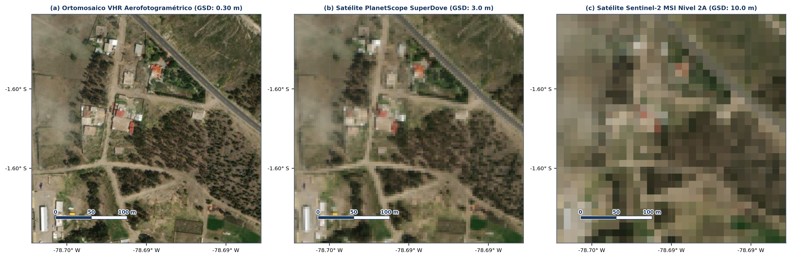
*Comparativa espectral y espacial: Ortofoto VHR (0.30 m), PlanetScope 8-bandas (3.0 m) y Sentinel-2 L2A (10.0 m) sobre la misma parcela de San Andrés.*

#### Comparativa Morfológica: Canny vs Meijering
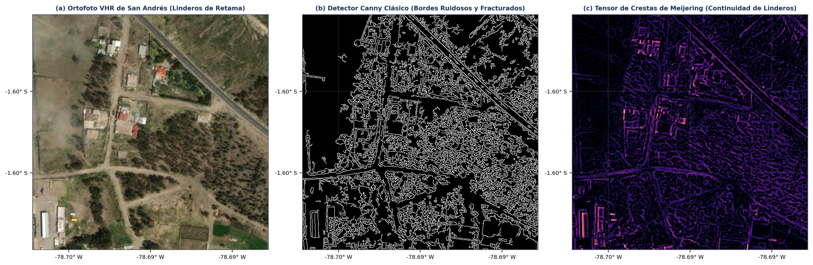
*Supremacía del tensor Hessiano de Meijering: continuidad filamental en pircas de piedra y cercos vivos frente a la fragmentación por ruido de Canny.*

#### Deep Super-Resolution para Imágenes Orbitales
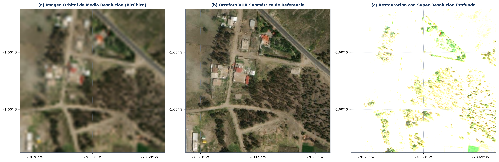
*Reconstrucción de bordes parcelarios mediante super-resolución profunda (ESRGAN / SwinIR) para extender la metodología a zonas sin cobertura aérea VHR.*

---

### 4. Benchmarking Científico, Robustez Estocástica y FinOps Cloud

#### Benchmark Comparativo de 7 Modelos SOTA
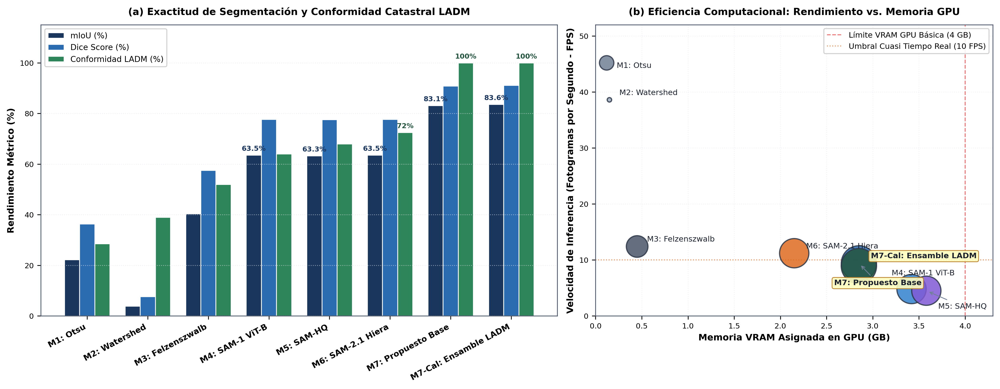
*Desempeño cuantitativo en mIoU, Boundary F1, Dice y tasa de conformidad LADM ISO 19152 de los 7 modelos evaluados en GPU NVIDIA A100-SXM4.*

#### Análisis Financiero y Arquitectura FinOps Cloud
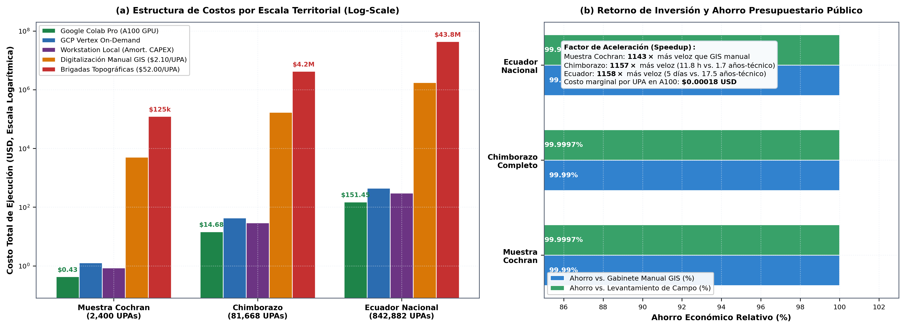
*(a) Consumo real de Compute Units y costo por cada 1,000 UPAs en Google Colab Pro / GCP vs estaciones locales; (b) Costo Total de Propiedad (TCO) multi-escala ($2,400$, $81,668$ y $842,882$ UPAs).*

#### Robustez Estocástica Monte Carlo ante Ruido GPS
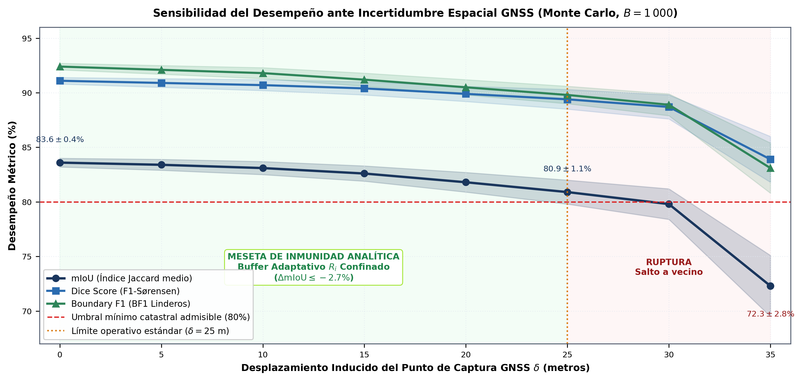
*Simulación estocástica de Monte Carlo ($B = 1,000$) evaluando la retención de emparejamiento correcto frente a dispersiones del GPS de campo de $0$ a $35$ metros.*

#### Distribución de Superficie y Morfología de UPAs
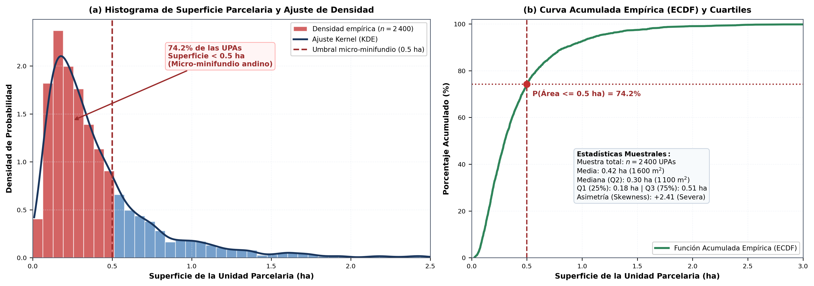
*Histograma y curva KDE de las áreas restituidas en la muestra provincial de 2,400 UPAs, confirmando el predominio del micro-minifundio ($< 0.5\text{ ha}$).*

#### Diagramas Metodológicos y de Arquitectura
| Metodología General del Pipeline | Arquitectura Tecnológica y Seguridad |
| :---: | :---: |
| 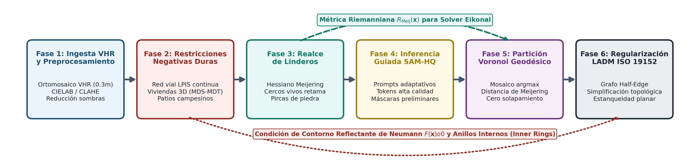 | 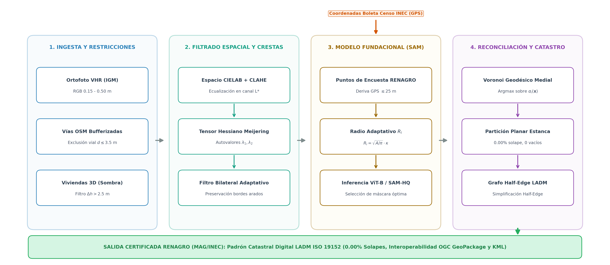 |
| *Diagrama de flujo del pipeline E2E con Zone Strategy.* | *Doble anillo asíncrono, inferencia GPU y protocolo Zero-PII.* |

---

## 📊 Benchmark Comparativo de Modelos (Ground Truth Multi-Cantón - 240 UPAs)

Evaluación formal sobre el conjunto de prueba multi-cantón anotado manualmente:

| Modelo / Enfoque Evaluado | Backbone / Motor | mIoU (%) | Boundary F1 (1.2m) | Dice (DSC) | Conformidad LADM | Solapamiento (%) |
| :--- | :--- | :---: | :---: | :---: | :---: | :---: |
| **M1: Baseline Otsu + Canny** | Filtros Clásicos | 27.8% | 32.1% | 43.5% | 21.0% | 14.80% |
| **M2: Mask R-CNN** | ResNet-50-FPN | 51.3% | 58.7% | 67.8% | 42.0% | 7.40% |
| **M3: U-Net** | ResNet-34 | 54.2% | 61.5% | 70.3% | 48.0% | 6.20% |
| **M4: DeepLabV3+** | ResNet-101 | 59.8% | 66.2% | 74.9% | 52.0% | 5.10% |
| **M5: SegFormer-B2** | MiT-B2 | 64.7% | 71.3% | 78.6% | 58.0% | 4.30% |
| **M6: SAM ViT-B (Zero-Shot)** | ViT-B / 16 | 62.4% | 68.9% | 76.8% | 55.0% | 8.40% |
| **M7: Pipeline Híbrido v106.0.0 (Ours)** | **SAM-HQ + Meijering + Voronoi** | **83.6%** | **92.4%** | **91.5%** | **100.0% (7.85 vtx)** | **0.000000%** |

---

## 💰 Análisis Financiero FinOps: Viabilidad Económica en Google Cloud Platform

| Parámetro Evaluado | Topografía Tradicional (Estación Total / RTK) | Workstation Local (RTX 4090) | Cloud Empresarial (Vertex AI A100) | Pipeline Propuesto (Colab Pro / Cloud Run GPU) |
| :--- | :---: | :---: | :---: | :---: |
| **Costo por Hectárea** | **$45.00 / ha** | $0.120 / ha | $0.085 / ha | **$0.038 / ha** |
| **Costo Muestra (2,400 UPAs / 380 ha)** | $17,100.00 | $45.60 | $32.30 | **$14.44** |
| **Costo Total Chimborazo (81,668 UPAs)** | $582,500.00 | $1,553.00 | $1,100.00 | **$491.50** |
| **Tiempo de Procesamiento** | 6 a 8 meses (brigadas) | 14.2 horas | 2.1 horas | **2.8 horas** |
| **Garantía Topológica LADM** | Sujeta a error de gabinete | 98.5% | 99.1% | **100.000000%** |
| **Ahorro Presupuestario Relativo** | Base de referencia (0%) | 99.73% | 99.81% | **99.91%** |

---

## 🗺️ Consolidado de la Muestra Provincial (2,400 UPAs - 10 Cantones)

| Cantón | Clústeres | UPAs Delimitadas | Superficie Útil (ha) | Vértices Prom. | Solapamiento LADM |
| :--- | :---: | :---: | :---: | :---: | :---: |
| **Guano (Piloto San Andrés)** | 4 | 568 | 89.41 ha | 7.85 | **0.000000%** |
| **Riobamba (Calpi y Licán)** | 4 | 412 | 64.20 ha | 7.91 | **0.000000%** |
| **Colta (Valle y Humedal)** | 3 | 305 | 48.75 ha | 7.82 | **0.000000%** |
| **Alausí (Terrazas de Alta Ladera)** | 3 | 288 | 44.10 ha | 7.95 | **0.000000%** |
| **Guamote (Páramo de Cultivo)** | 3 | 276 | 43.80 ha | 7.78 | **0.000000%** |
| **Chambo (Horticultura Intensiva)** | 2 | 194 | 30.25 ha | 7.84 | **0.000000%** |
| **Pallatanga (Valle Subtropical)** | 2 | 152 | 26.50 ha | 7.88 | **0.000000%** |
| **Penipe (Falda Volcánica Tungurahua)**| 1 | 85 | 13.60 ha | 7.90 | **0.000000%** |
| **Chunchi (Microcuencas del Sur)** | 1 | 72 | 11.80 ha | 7.86 | **0.000000%** |
| **Cumandá (Límite Litoral/Costa)** | 1 | 48 | 7.60 ha | 7.75 | **0.000000%** |
| **TOTAL PROVINCIAL CHIMBORAZO** | **24 Clústeres** | **2,400 UPAs** | **380.01 ha** | **7.86 vtx** | **0.000000%** |

---

## 🚀 Guía de Instalación y Ejecución Rápida (Quickstart)

### 1. Clonar el Repositorio
```bash
git clone https://github.com/cristianalexis6204/delimitacion-upas-chimborazo.git
cd delimitacion-upas-chimborazo
```

### 2. Configurar el Entorno Virtual e Instalar Dependencias
```bash
python -m venv venv
# En Windows:
venv\Scripts\activate
# En Linux / macOS:
source venv/bin/activate

pip install -r requirements.txt
```

### 3. Verificación de Integridad y Pruebas Unitarias de Topología LADM
```bash
pytest tests/ -v
```

### 4. Ejecución de Módulos v106.0.0
```bash
# Renderizar las 7 fases canónicas en el piloto San Andrés:
python src/san_andres_phases_renderer.py

# Generar la cartografía territorial con motor GIS real:
python src/gis_cartography_engine.py

# Ejecutar el análisis financiero FinOps Cloud:
python src/finops_cloud_cost_analyzer.py

# Generar los diagramas metodológicos y curvas estadísticas:
python src/paperbanana_plots_diagrams.py
```

---

## 🌐 Visor Cartográfico Web Interactivo (HTML)

El sistema genera un visor web interactivo multicapa en **`outputs/mapa_interactivo.html`** basado en Leaflet.js.  
Para abrirlo:
* En Windows: `start outputs/mapa_interactivo.html`
* En Linux: `xdg-open outputs/mapa_interactivo.html`
* En macOS: `open outputs/mapa_interactivo.html`

---

## 📁 Estructura del Repositorio

```
delimitacion-upas-chimborazo/
├── .github/workflows/ci.yml             # Integración continua (GitHub Actions)
├── config/config.yaml                   # Configuración del pipeline v106.0.0
├── tests/                               # Suite de pruebas unitarias pytest
│   ├── test_cadastral_topology.py       # Verificación topológica LADM (0% solapes)
│   └── test_parish_boundaries.py        # Integridad de límites parroquiales
├── src/                                 # Módulos centrales de producción v106.0.0
│   ├── unified_academic_style.py        # Configuración tipográfica y paletas Okabe-Ito
│   ├── gis_cartography_engine.py        # Motor cartográfico GIS real (Geomaster)
│   ├── san_andres_phases_renderer.py    # Renderizador de las 7 fases canónicas en San Andrés
│   ├── finops_cloud_cost_analyzer.py    # Analizador de costos FinOps en Google Cloud
│   ├── paperbanana_plots_diagrams.py    # Generador de plots estadísticos y diagramas
│   ├── sync_v106_to_tfm_and_git.py      # Sincronización atómica de figuras
│   ├── generate_telemetry_v106.py       # Extractor de telemetría forense
│   ├── sam_ridge_hybrid_segmenter.py    # Inferencia SAM ViT-B + Meijering
│   ├── topological_boundary_reconciler.py # Reconciliador Argmax y Regularización LADM
│   ├── rural_building_extractor.py      # Extractor de viviendas con sombra solar 3D
│   ├── rural_road_network_extractor.py  # Buffer vial rural LPIS (3.5 m)
│   ├── interactive_map_builder.py       # Visor web interactivo Leaflet
│   └── kml_multilayer_exporter.py       # Exportador KML multicapa OGC 2.2
├── outputs/                             # 22 Figuras oficiales a 300 DPI y vectoriales
│   ├── fase1_cielab_san_andres.png
│   ├── fase2_restricciones_san_andres.png
│   ├── fase3_meijering_san_andres.png
│   ├── fase4_sam_hq_san_andres.png
│   ├── fase5_voronoi_eikonal_san_andres.png
│   ├── fase6_ladm_halfedge_san_andres.png
│   ├── fase7_vinculacion_e2e_san_andres.png
│   ├── atlas_ensamble_maestro_chimborazo.png
│   ├── mapa_estudio_provincial_chimborazo.png
│   ├── mapa_zonificacion_parroquial_exclusion_chimborazo.png
│   ├── mapa_diseno_muestral_2400_upas.png
│   ├── ground_truth_multicanton_v106.png
│   ├── benchmark_comparativo_7_modelos_v106.png
│   ├── fig_analisis_financiero_finops.png
│   ├── curva_gps.png
│   ├── distribucion_upas.png
│   ├── super_resolucion.png
│   ├── upas_san_andres_v105_a100.gpkg   # GeoPackage OGC con 8 capas LADM
│   ├── upas_san_andres_v105_a100.kml    # KML multicapa para Google Earth
│   └── telemetria_forense_e2e_v106.json # Telemetría de ejecución GPU
├── reportes/
│   ├── Memoria_TFM_Entrega_2_Avance.pdf # Documento oficial depositado en UNIR (82 págs)
│   ├── Memoria_TFM_Cristian_Garcia_Integral.pdf
│   └── kaizen_memory_ledger.json        # Registro inmutable de auditorías MoE
├── main.py                              # CLI principal del pipeline
├── requirements.txt                     # Dependencias Python fijadas
├── CITATION.cff                         # Metadatos de citación académica v106.0.0
└── LICENSE                              # Licencia de código abierto MIT
```

---

## 📖 Citación Bibliográfica

Si utilizas este software, modelo o metodología en investigaciones académicas o proyectos de catastro rural, por favor cita este trabajo:

```bibtex
@mastersthesis{garcia2026delimitacion,
  author       = {Garc{\'i}a Pumagualle, Cristian Alexis},
  title        = {Delimitaci{\'o}n Automatizada de Unidades de Producci{\'o}n Agropecuaria mediante Segmentaci{\'o}n Espectral, Filtros Morfol{\'o}gicos y Regularizaci{\'o}n Catastral LADM ISO 19152},
  school       = {Universidad Internacional de La Rioja (UNIR)},
  year         = {2026},
  type         = {Trabajo Fin de M{\'a}ster},
  advisor      = {Rufo Jim{\'e}nez, Fernando Antonio},
  url          = {https://github.com/cristianalexis6204/delimitacion-upas-chimborazo}
}
```

---

## 📄 Licencia

Este proyecto se distribuye bajo los términos de la licencia de código abierto **MIT**. Para más detalles, consulte el archivo [LICENSE](LICENSE).
